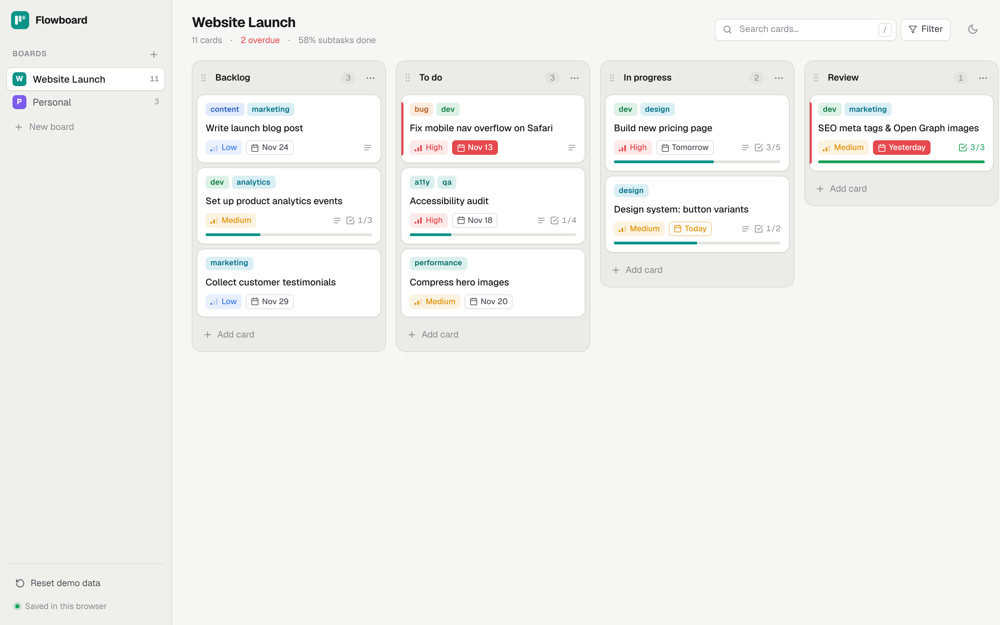
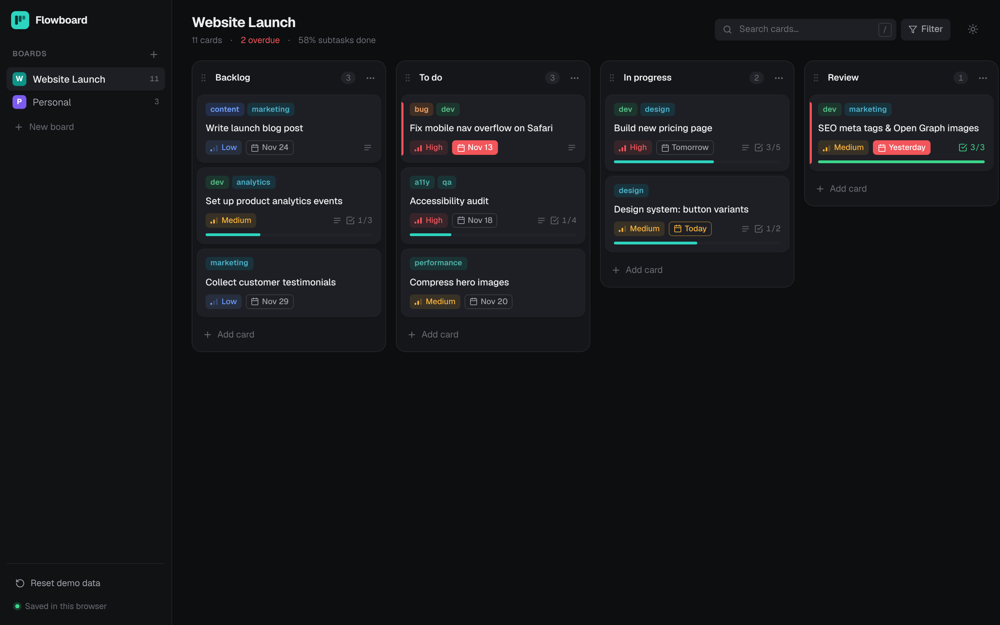
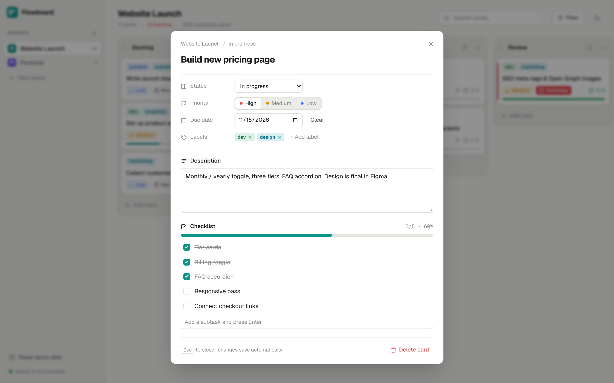
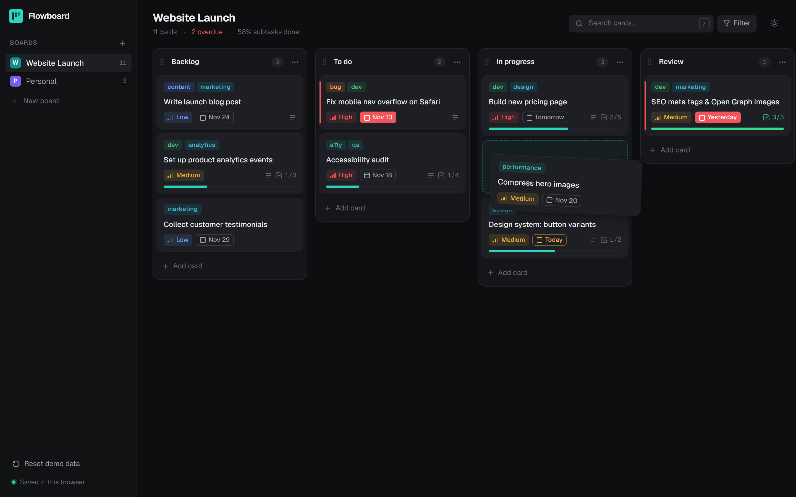
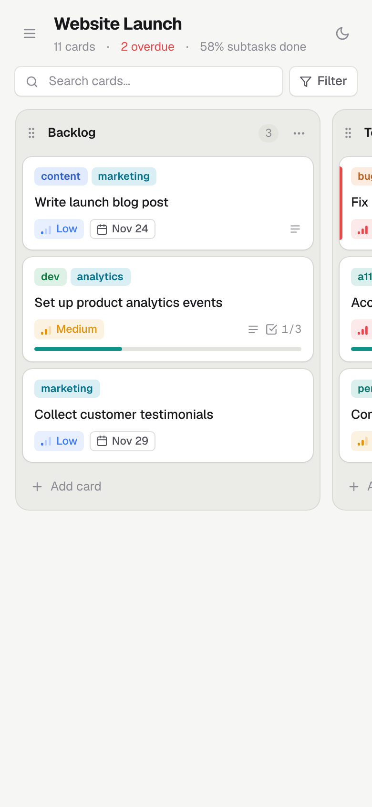

# Flowboard

**A calm, fast Kanban task manager: drag-and-drop boards, rich cards and a dark mode, all running in the browser.**



| Dark mode | Card editor |
| --- | --- |
|  |  |

| Drag & drop | Mobile |
| --- | --- |
|  |  |

## Features

- **Multiple boards**: create, rename (double-click or the ⋯ menu) and delete boards from the sidebar.
- **Columns**: add, rename, delete (with confirmation when the column has cards), and reorder them by dragging the grip or with "Move left / right".
- **Task cards** with title, description, **priority** (low / medium / high colored badges), **due date** (today shown in amber, overdue shown in red with a red edge on the card), **labels** (each label gets a stable color) and **checklist subtasks** with a progress bar.
- **Drag & drop** cards within and between columns, with a tilted floating overlay and a smooth drop animation. Works with mouse, touch (press and hold) and **keyboard** (focus a card, press <kbd>Space</kbd> to pick it up, use the arrow keys, then <kbd>Space</kbd> again to drop, or <kbd>Esc</kbd> to cancel).
- **Card detail modal**: every field can be edited there and changes save as you type. <kbd>Esc</kbd> or a click on the backdrop closes it, and focus stays inside the modal while it's open.
- **Search + filters**: free-text search over titles, descriptions and labels (press <kbd>/</kbd> to jump to it), plus filters for priority and label. Columns show `visible/total` counts while filtering.
- **Auto-save to localStorage**: refresh the page and everything is still there.
- **Demo workspace** ("Website Launch" + "Personal") on first load. Due dates are relative to today, so the demo always has overdue and upcoming tasks. **Reset demo data** is in the sidebar footer.
- **Dark / light theme** that follows your OS by default and remembers your choice, with no flash on reload.
- **Empty states** for empty columns, filtered-out columns and the case where no boards are left.
- **Responsive**: on phones the sidebar becomes a drawer, columns snap-scroll sideways and the card editor opens as a bottom sheet.

## Tech stack

| Tech | Why |
| --- | --- |
| **React 18** (function components + hooks) | Component model I know well; hooks keep logic small and readable. |
| **useReducer + Context** | All board data changes go through one pure, testable reducer. It works like a small Redux without the extra library. |
| **@dnd-kit** (`core`, `sortable`, `utilities`) | The one extra dependency. Accessible drag & drop (keyboard + screen-reader announcements), works on touch, and is still maintained. Writing this by hand would take weeks. |
| **Vite** | Instant dev server and a simple production build. |
| **Plain CSS + CSS variables** | Design tokens in `:root` make theming trivial: dark mode is just a second set of variables. No CSS framework needed. |
| **localStorage** | The brief is frontend-only, and localStorage is enough to persist one user's boards. |

## Project structure

```
flowboard/
├── index.html               # Fonts + tiny script that applies the theme before React loads
├── vite.config.js           # Dev/preview on port 5101
├── docs/screenshots/
└── src/
    ├── main.jsx             # Entry: wraps <App> in <BoardProvider>
    ├── App.jsx              # Layout + UI-only state (filters, open card, drawer)
    ├── state/
    │   ├── boardReducer.js  # ⭐ Every state change, heavily commented
    │   ├── BoardContext.jsx # Provider, useBoardState/useBoardDispatch, auto-save
    │   ├── demoData.js      # Builds the demo workspace
    │   └── storage.js       # Safe localStorage load/save
    ├── components/
    │   ├── Board.jsx        # DndContext, collision logic, drag handlers
    │   ├── Column.jsx       # Sortable column + its card list
    │   ├── TaskCard.jsx     # Purely visual card (reused in the drag overlay)
    │   ├── SortableTaskCard.jsx
    │   ├── CardModal.jsx    # Card editor
    │   ├── Sidebar.jsx      # Boards list, reset demo
    │   ├── Toolbar.jsx      # Title, stats, search, filters, theme toggle
    │   ├── FilterMenu.jsx, Modal.jsx, ConfirmDialog.jsx, Dropdown.jsx, ...
    │   └── Icons.jsx        # Inline SVG icons (no icon library)
    ├── hooks/               # useTheme, useClickOutside
    ├── utils/               # dates, filters, labels, id helpers (pure functions)
    └── styles/              # base (tokens), layout, board, card, modal
```

## Getting started

Requires Node 18+.

```bash
npm install
npm run dev        # http://localhost:5101
```

Production build:

```bash
npm run build
npm run preview    # serves dist/ on http://localhost:5101
```

## How the state works (interview notes)

The state is **normalized**: boards, columns and tasks are stored in lookup objects keyed by id, and parents only keep **ordered arrays of ids**:

```js
{
  boards:  { b1: { id, name, color, columnIds: ['c1', 'c2'] } },
  columns: { c1: { id, title, taskIds: ['t1', 't2'] } },
  tasks:   { t1: { id, title, description, priority, dueDate, labels, checklist } },
  boardOrder: ['b1'],
  activeBoardId: 'b1',
}
```

So moving a card is just *remove an id from one array and insert it into another* (`TASK_MOVE`), and editing a card never touches its column. Components read the state with `useBoardState()` and change it with `dispatch({ type: ACTIONS.TASK_UPDATE, taskId, changes })`. State and dispatch live in two separate contexts, so components that only dispatch don't re-render. A debounced `useEffect` in the provider writes the state to localStorage after each change.

Drag & drop: `onDragOver` moves a card into another column while you hover (so you can see it land there), `onDragEnd` handles reordering within a column and moving columns, and `onDragCancel` puts the card back where it started.

## What I learned

> Built with AI assistance (Claude). I planned the features, reviewed the code, tested it, and customized the design.

- **Planning the data before the UI.** I kept boards, columns and cards in one simple object, with cards stored by id. This made adding, moving and deleting cards much easier.
- **Managing state with a reducer.** All changes (add card, move card, rename column…) go through one `boardReducer`, so the logic lives in one place and is easy to follow.
- **Saving without a backend.** The board is saved in the browser's localStorage, so the user's tasks are still there after a refresh.

## ملخص بالعربي

**Flowboard** هو تطبيق لإدارة المهام بأسلوب كانبان، ويعمل بالكامل في المتصفح بدون خادم. مبني بـ React و Vite. يدعم التطبيق عدة لوحات وأعمدة يمكن إضافتها وإعادة تسميتها وحذفها وإعادة ترتيبها. تحتوي كل بطاقة مهمة على وصف وأولوية ملوّنة وتاريخ استحقاق (يظهر باللون الأحمر عند التأخر) ووسوم وقائمة مهام فرعية مع شريط تقدم. يمكن سحب البطاقات وإفلاتها بين الأعمدة باستخدام مكتبة dnd-kit، وذلك بالفأرة أو باللمس أو بلوحة المفاتيح. يتضمن التطبيق كذلك بحثاً وتصفية حسب الأولوية والوسم، ويحفظ البيانات تلقائياً في localStorage، ويوفر الوضع الداكن والفاتح ولوحة تجريبية جاهزة يمكن إعادة ضبطها. تُدار الحالة باستخدام useReducer و Context، مع reducer مشروح بالتعليقات ليسهل شرحه في المقابلات.

للتشغيل: `npm install` ثم `npm run dev` وافتح المتصفح على `http://localhost:5101`.
